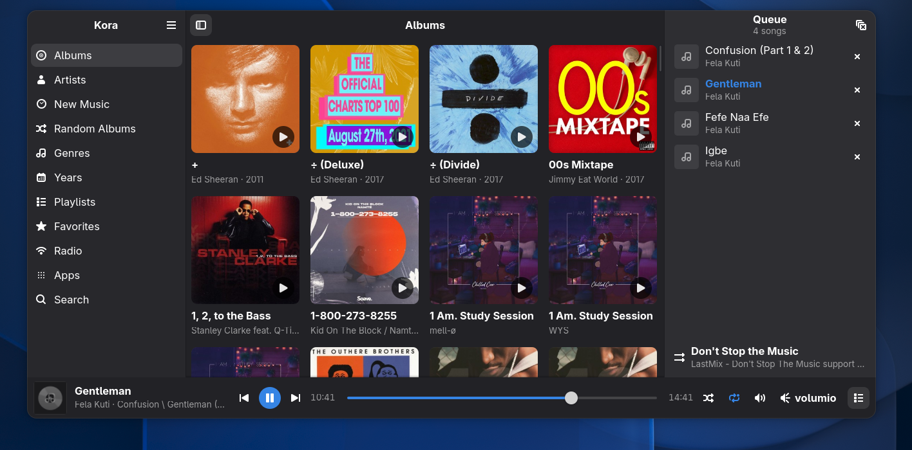
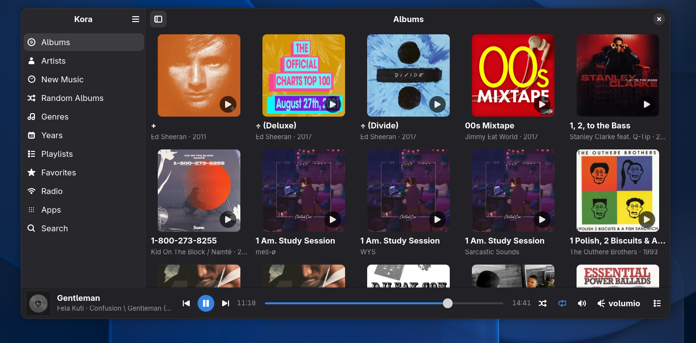
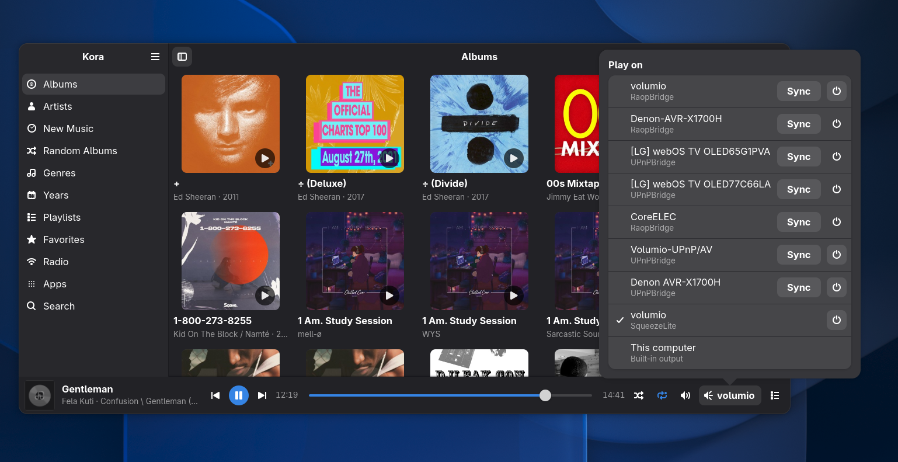

<p align="center">
  
</p>

<h1 align="center">Kora</h1>

<p align="center">
  A GTK4 and libadwaita music client for <b>Lyrion Music Server</b><br>
  (formerly Logitech Media Server / Squeezebox Server)
</p>



Kora is a native Linux desktop app for browsing and playing the music on your
Lyrion Music Server (LMS). It talks to the server directly, so you can browse
your library, control every player in the house, group players for multi-room
playback, and listen on the computer you are sitting at.

It is named after the kora, the 21-string West African harp-lute.

## What it does

- **Browse your library**: albums (with artwork), artists, new music, random
  albums, genres, years and playlists. Album pages can be shown as a grid or a
  compact list (main menu, View).
- **Search** artists, albums and songs as you type.
- **Radio, Apps and Favorites**: browse any LMS plugin menu, including the
  ones that ask for a search term.
- **Control any player**: play, pause, skip, seek, volume, shuffle, repeat and
  power for every player the server knows about.
- **Multi-room**: switch between players and sync or unsync them from the
  player menu.
- **Queue**: a side panel where you can jump to a track, remove one, or clear
  everything.
- **Don't Stop The Music**: the repeat button cycles through off, repeat
  song, repeat queue and Don't Stop The Music, like the LMS web interface.
  Choose which provider it uses, per player, at the bottom of the queue panel.
- **Listen on this computer**, in one of two ways:
  - *This computer*: a built-in output that streams library tracks straight
    from the server. Nothing else to install.
  - *Squeezelite*: if `squeezelite` is installed, Kora can start it for you so
    this machine becomes a full LMS player with sync, gapless playback, radio
    and apps.
- **Desktop integration**: MPRIS support, so keyboard media keys and the GNOME
  media controls work with whichever player is selected.
- **Finds your server** on the local network, with optional username and
  password for protected servers.
- **Adaptive layout** that rearranges itself in narrow windows.

| Album grid | Player menu with sync |
| --- | --- |
|  |  |

## Install

Kora needs GTK 4.12 or newer and libadwaita 1.5 or newer. That covers current
Fedora and Ubuntu releases, plus Ubuntu 24.04 and Debian 13.

### Fedora

```bash
sudo dnf install git rpm-build
git clone https://github.com/bigbrovar/Kora.git
cd Kora
./build-packages.sh rpm
sudo dnf install ./dist/kora-*.noarch.rpm
```

### Ubuntu and Debian

```bash
sudo apt install git
git clone https://github.com/bigbrovar/Kora.git
cd Kora
./build-packages.sh deb
sudo apt install ./dist/kora_*_all.deb
```

After installing, Kora appears in your application menu, and `kora` works as a
command in a terminal. The package pulls in GTK4, libadwaita, PyGObject and
GStreamer. Squeezelite and the extra GStreamer codecs are recommended but not
required.

### Run from source without installing

Install the libraries, then start it from the checkout:

```bash
# Fedora
sudo dnf install python3-gobject gtk4 libadwaita gstreamer1-plugins-base \
     gstreamer1-plugins-good gstreamer1-plugin-libav

# Ubuntu / Debian
sudo apt install python3-gi gir1.2-gtk-4.0 gir1.2-adw-1 gir1.2-gstreamer-1.0 \
     gstreamer1.0-plugins-base gstreamer1.0-plugins-good gstreamer1.0-libav

git clone https://github.com/bigbrovar/Kora.git
cd Kora
python3 -m kora
```

## First run

1. Start Kora. It looks for Lyrion Music Servers on your network and lists the
   ones it finds. Click one, or type the server address and port (the default
   port is 9000).
2. Pick where the music should play from the player button at the bottom
   right. Every player known to the server is listed, plus *This computer*.
3. Browse, press play.

To make the computer you are on a full LMS player (needed for sync, most
streaming apps and Don't Stop The Music), install Squeezelite and switch on
**Run Squeezelite while Kora is open** in Preferences:

```bash
sudo dnf install squeezelite     # Fedora
sudo apt install squeezelite     # Ubuntu / Debian
```

## Keyboard shortcuts

| Keys | Action |
| --- | --- |
| Ctrl+F | Search |
| Ctrl+Space | Play / pause |
| Ctrl+Right, Ctrl+Left | Next / previous track |
| Ctrl+1, Ctrl+2 | Albums as list / as grid |
| F9 | Show or hide the queue |
| Ctrl+, | Preferences |
| Ctrl+Q | Quit |

Your keyboard's media keys work too.

## Good to know

- The built-in *This computer* output plays library files and plain http(s)
  streams. Content that only the server can resolve (most streaming-service
  apps) needs a real LMS player: pick one from the player menu, or enable
  Squeezelite.
- The built-in output is not gapless and cannot join a sync group. Squeezelite
  can do both.
- Don't Stop The Music is a server plugin, so it works with LMS players and
  Squeezelite, not with the built-in output. It has to be enabled in the
  server settings.
- Player state is refreshed once a second.
- Settings are stored in `~/.config/kora/config.json`. If your server needs a
  password, it is saved there in plain text, readable only by your user.
- To send the built-in output to a specific audio device, set
  `KORA_AUDIO_SINK`, for example
  `KORA_AUDIO_SINK="alsasink device=hw:1,0" kora`.

## Troubleshooting

Kora prints what it is doing to the terminal, so start it from one if
something is wrong.

- **No window appears**: run `kora --diagnose` (or `python3 -m kora --diagnose`
  from source). It starts Kora five times for a few seconds each with
  different optional parts switched off, then prints which combinations worked.
- **Start with the extras off**: `kora --safe` skips the custom styling, the
  adaptive layout and MPRIS. `--without=css`, `--without=breakpoints` or
  `--without=mpris` leave out one of them.
- **Small grey text looks cut off at the top**: try a slightly larger size,
  for example `KORA_SMALL_TEXT=92% kora`, and report which size fixes it.
- **A format will not play on This computer**: install the extra GStreamer
  codecs (`gstreamer1-plugin-libav` on Fedora, `gstreamer1.0-libav` on Ubuntu).

Please open an [issue](https://github.com/bigbrovar/Kora/issues) with the
terminal output if you hit a problem.

## Building packages

`build-packages.sh` produces a `.deb` and an `.rpm` in `dist/`. Both are
architecture independent, so either can be built on either distribution.

```bash
sudo dnf install rpm-build dpkg     # on Fedora
sudo apt install rpm                # on Ubuntu

./build-packages.sh                 # both packages
./build-packages.sh rpm             # or just one: rpm | deb
```

Set `MAINTAINER="Your Name <you@example.com>"` to record yourself in the
packages and `RELEASE=2` to bump the package revision. The version number comes
from `kora/__init__.py`.

## Development

Kora is written in Python with PyGObject. There is no build step.

`tests/mock_lms.py` is a small fake server (library, artwork, three players,
radio, discovery) for working without a real LMS:

```bash
python3 tests/mock_lms.py 9000 &     # then connect Kora to localhost:9000
python3 tests/test_client.py         # client and player backend tests
```

| Path | Purpose |
| --- | --- |
| `kora/lms.py` | JSON-RPC client and server discovery (standard library only) |
| `kora/players.py` | LMS player control, built-in GStreamer output, Squeezelite launcher |
| `kora/window.py` | Main window, player bar, queue, player menu, preferences |
| `kora/pages.py` | Grid and list browse pages, album and playlist page, search |
| `kora/mpris.py` | MPRIS2 D-Bus service |
| `kora/util.py` | Thread helper and artwork cache |
| `data/` | Icon, launcher entry, AppStream metadata |
| `packaging/`, `build-packages.sh` | Package launcher and build script |

## License

GPL-3.0-or-later. See [LICENSE](LICENSE).

Kora is an independent project. It is not affiliated with or endorsed by the
Lyrion Music Server project or Logitech.
